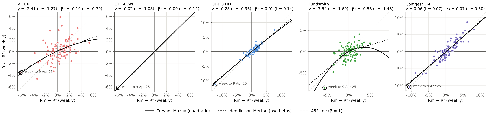
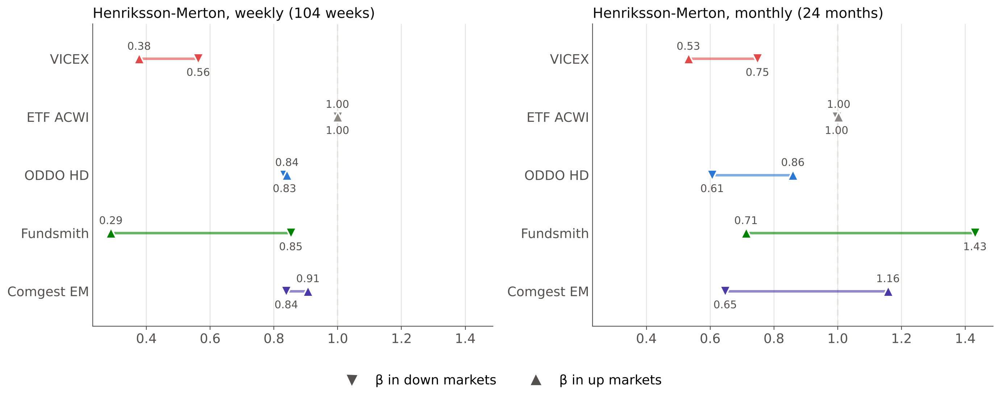
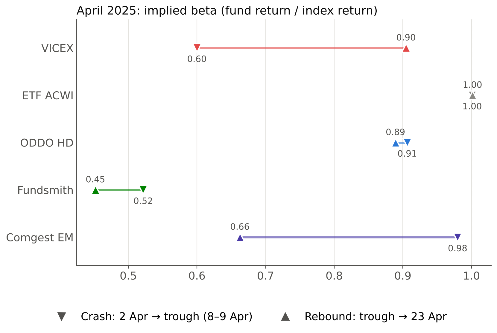
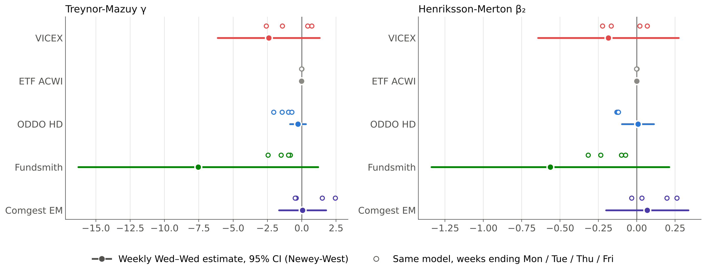
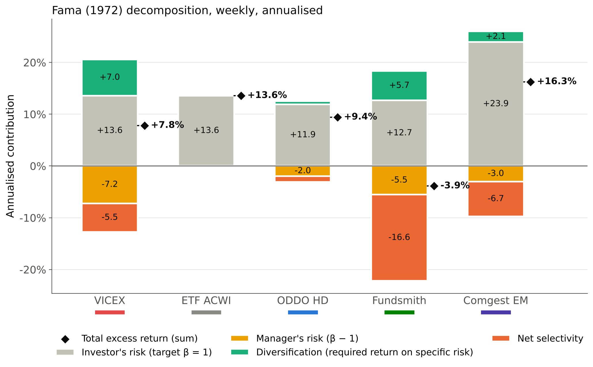
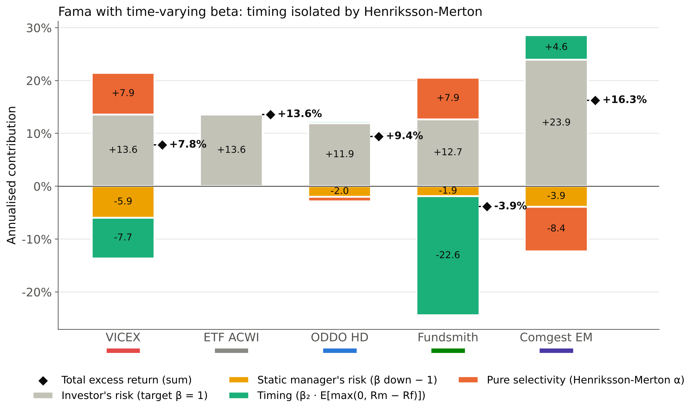
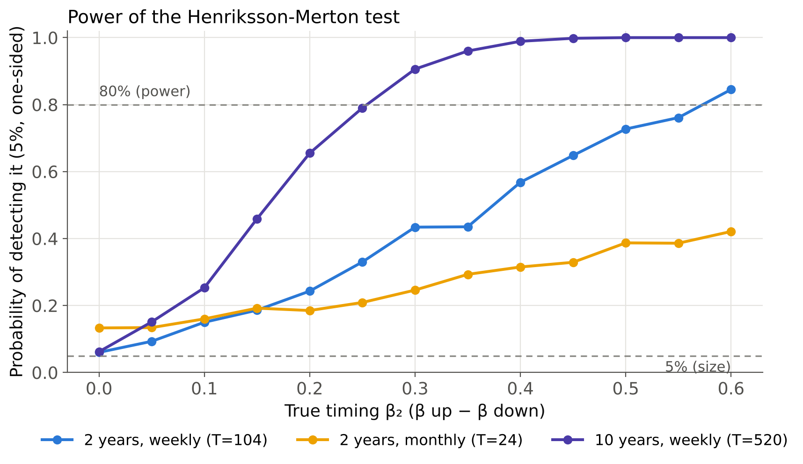

# Can fund managers time the market?

[](https://github.com/<your-username>/fund-market-timing/actions/workflows/tests.yml)

Market-timing analysis of five equity funds over two years (September 2024 to September 2026) with **Treynor-Mazuy**, **Henriksson-Merton** and the **Fama (1972) decomposition**, separating timing in up and down markets.

Course project for *Asset Management & Performance Measurement*, Master 272 Financial Engineering, Université Paris-Dauphine (October 2026).

## Key findings

1. **No active manager shows robust positive timing**, in line with the literature since Treynor-Mazuy (1966) and Henriksson (1984). The passive ETF used as a control comes out with β = 1.00 and zero timing in every specification, which validates the pipeline.
2. **The only robust signal is negative: Fundsmith.** On monthly data, free of its noon-NAV asynchrony, its beta is 1.43 in down markets and 0.71 in up markets (β₂ = −0.72, t = −2.40). β₂ is negative for all five week-end days.
3. **One week drives the significance.** The strongly significant up/down asymmetries (|t| ≈ 4) for ODDO and Fundsmith disappear when 2 weeks out of 104, around the April 2025 tariff crash, are removed.
4. **Fama cannot see timing.** Bridging Fama with Henriksson-Merton splits Jensen's alpha exactly into pure selectivity, timing and a static beta gap. For Fundsmith: −11.0% = +7.9% (selectivity) − 22.6% (timing) + 3.7% (static beta gap, (β_down − β_CAPM) × premium). The split is imprecise because α̂ and β̂₂ are strongly negatively correlated (−0.60 to −0.87).
5. **Two years of data have little power.** A Monte Carlo calibrated on the sample shows that a true β₂ of 0.30 is detected less than half the time with 104 weekly observations. With 24 monthly observations the test also over-rejects (about 13% at a nominal 5%), so the monthly Fundsmith result is suggestive rather than conclusive.
6. **Data handling changes the conclusions.** Not reinvesting VICEX's distributions moves its alpha from +1.5% to −5.8% a year; using Fundsmith's daily NAV creates a spurious significant γ.

## Funds

| Fund | Style | Benchmark (Net Return) | Fund / index return | β | R² |
|---|---|---|---|---|---|
| USA Mutuals Vice Fund (VICEX) | US "vice" stocks: tobacco, alcohol, gaming, defence | MSCI ACWI, USD | +25.1% / +40.3% | 0.47 | 0.23 |
| iShares MSCI ACWI UCITS ETF | **Passive control**: no decision, must show no timing | MSCI ACWI, USD | +40.3% / +40.3% | 1.00 | 1.00 |
| ODDO BHF European High Dividend | French fund, European high dividend | MSCI Europe, EUR | +24.2% / +30.0% | 0.84 | 0.89 |
| Fundsmith Equity | Global quality stocks, low turnover | MSCI World, GBP | −0.9% / +37.9% | 0.56 | 0.31 |
| Comgest Growth Emerging Markets | Emerging-market growth | MSCI EM, EUR | +38.9% / +61.3% | 0.87 | 0.83 |

Cumulative returns and CAPM beta over the 104 weeks.

## Models

| Model | Equation | Timing if |
|---|---|---|
| Treynor-Mazuy | Rp − Rf = α + β (Rm − Rf) + γ (Rm − Rf)² | γ > 0 (convex relation) |
| TM, up / down | same with γ_up on up weeks and γ_down on down weeks | γ_up > 0 and γ_down > 0 |
| Henriksson-Merton | Rp − Rf = α + β₁ (Rm − Rf) + β₂ max(0, Rm − Rf) | β₂ = β_up − β_down > 0 |
| Fama | excess return = net selectivity + diversification + manager's risk + investor's risk | (timing through the HM bridge) |

Weekly returns, Wednesday to Wednesday, Newey-West standard errors (4 lags), up week if Rm > Rf. Full details, choices and alternatives in [`docs/methodology.md`](docs/methodology.md).

## Results

### Timing coefficients

| Fund | γ TM (t) | β₂ HM (t) | β down → β up | HM timing, % a year |
|---|---|---|---|---|
| VICEX | −2.41 (−1.27) | −0.19 (−0.79) | 0.56 → 0.38 | −7.7 |
| ETF ACWI | −0.02 (−1.08) | −0.00 (−0.12) | 1.00 → 1.00 | 0.0 |
| ODDO HD | −0.28 (−0.96) | 0.01 (0.14) | 0.83 → 0.84 | +0.3 |
| Fundsmith | −7.54 (−1.69) | −0.56 (−1.43) | 0.85 → 0.29 | −22.6 |
| Comgest EM | 0.06 (0.07) | 0.07 (0.50) | 0.84 → 0.91 | +4.6 |



### Up and down markets



The weekly Fundsmith estimate is blurred by its noon NAV; the monthly panel is the reference for that fund.

### April 2025 tariff crash

Implied beta = fund return / index return, during the crash (2 April to the trough) and the rebound (trough to 23 April). A good timer is on the left in the crash and on the right in the rebound. Only VICEX has that profile, and it is explained by its sectors (tobacco and defence hold up in crises), not by a decision.



### Robustness: the week-end day matters

Full dots: Wednesday-to-Wednesday estimate with 95% CI. Hollow dots: the same model with weeks ending Monday, Tuesday, Thursday or Friday.



### Fama decomposition and the bridge to timing



Net selectivity is negative for all four active managers. Comgest's +16.3% a year comes entirely from the emerging-market premium (+23.9%).



### Statistical power



All tables are in [`results/tables/`](results/tables) (CSV) and in [`results/market_timing_results.xlsx`](results/market_timing_results.xlsx) (one sheet per table).

## Data

Daily NAVs, benchmark levels and risk-free rates were extracted from a Bloomberg terminal at Université Paris-Dauphine. They are licensed and **not included**. [`data/README.md`](data/README.md) gives the expected format and the two adjustments applied (VICEX distributions, Fundsmith NAV timing).

A synthetic workbook with the same layout and known timing profiles is provided, so the whole pipeline runs without the licensed data.

## Usage

```bash
git clone https://github.com/MarcMessant/fund-market-timing.git
cd fund-market-timing
pip install -e ".[dev]"

pytest                                                  # tests
python scripts/run_analysis.py --data data/synthetic_fund_data.xlsx --out results_synthetic --raw
python scripts/run_analysis.py --data data/fund_data.xlsx --out results   # with your own data
python scripts/power_simulation.py --out results        # about 2 minutes
```

## Repository structure

```
├── src/market_timing/
│   ├── config.py         funds, benchmarks, sample window, palette, data adjustments
│   ├── data.py           loading, total-return index, weekly / daily / monthly returns
│   ├── models.py         CAPM, Treynor-Mazuy (+ asymmetric), Henriksson-Merton, Dimson
│   ├── fama.py           Fama decomposition and the Fama → timing bridges
│   ├── analysis.py       full study, robustness checks, passive control
│   ├── plots.py          figures
│   └── report.py         CSV and Excel export
├── scripts/
│   ├── run_analysis.py
│   ├── make_synthetic_data.py
│   └── power_simulation.py
├── tests/                estimators recover known parameters, decompositions add up, calendar
├── data/                 data format and synthetic workbook (raw data not included)
├── docs/methodology.md
└── results/              figures and tables from the real data
```

## Author

Marc Messant, Master 272 Financial Engineering, Université Paris-Dauphine.

Code released under the MIT License. The license does not cover fund or index data.
